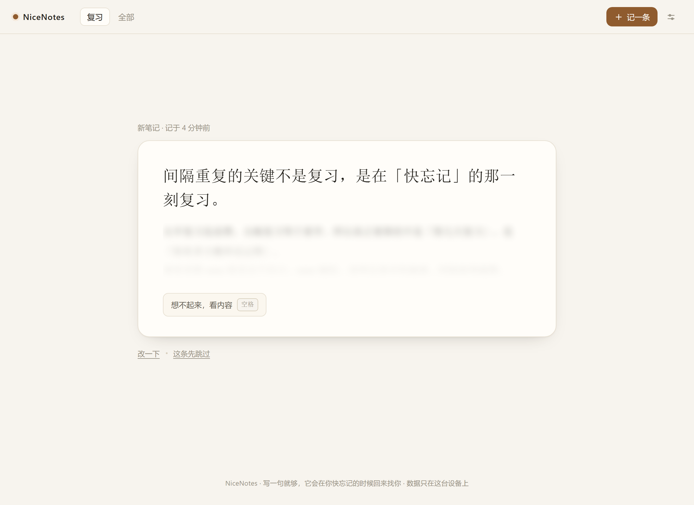
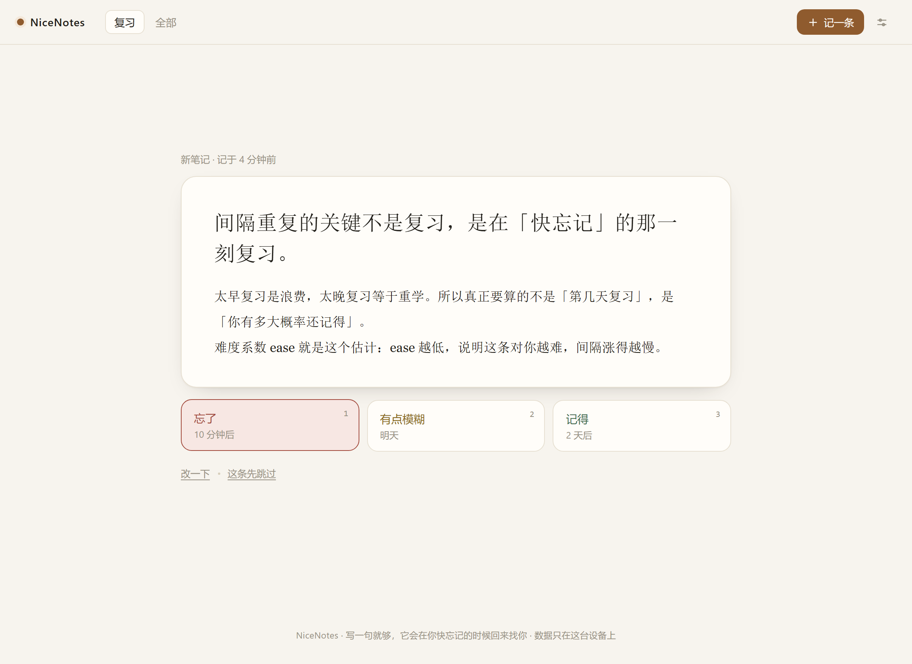

# NiceNotes

**写一句就够。它会在你快忘记的时候，自己回来找你一次。**

[](../../actions)




## 这不是又一个笔记工具

你装过的笔记软件大概都是这样：写进去，然后再也不打开。问题不在编辑器，也不在 Markdown 支持好不好——**笔记只进不出**，没有出口，就变成坟墓。

这个项目只做一件事：**让你写下的东西按遗忘曲线回来找你。**

打开就是一条笔记，没有目录树、没有列表、没有「今日待办」。第二行之后先糊住，逼你先自己回想；想不起来再展开，然后按三个按钮：

| 按钮 | 含义 | 下次出现 |
|---|---|---|
| 忘了 | 完全没想起来 | 10 分钟后 |
| 有点模糊 | 想起来了，但不确定 | 明天 |
| 记得 | 清楚记得 | 2 天后 |

间隔会随复习次数拉长，最长一年。三个按钮下面直接写着下次时间——这行小字是整个产品最重要的反馈，它让你相信系统真的在管这件事。



## 技术上有意思的地方

### 1. 本地优先，不是「离线可用」

所有数据先写 IndexedDB，永远以本地为准。没有网络的时候它就是完整的应用，不是降级版。

不登录也能一直用，一个字节都不会离开这台设备。登录只是多一个能力：换设备时把笔记接回来。

### 2. 同步不是上传备份，是两台设备交换事实

这是这个项目真正花时间的部分。绝大多数「加个同步」的做法是「整库覆盖」，两台设备同时改就丢数据。这里做的是增量 + 冲突显式化：

```
客户端                          服务端
  │  POST /sync                  │
  │  since: 42                   │  → 取 seq > 42 的所有笔记（增量拉取）
  │  notes: [改过的笔记]           │  → 逐条比较 updatedAt
  │   每条带 baseUpdatedAt        │     双方都改过 = 真冲突
  │                              │     落败的一方写进 note_history
  │  ← { since, notes, conflicts }
```

关键在于每条笔记多带一个 `baseUpdatedAt`：**客户端上次同步时看到的版本**。服务端据此能分清三种情况：

| 服务端变了 | 本地变了 | 处理 |
|---|---|---|
| 否 | 否 | 跳过 |
| 是 | 否 | 直接用服务端版本 |
| 否 | 是 | 接受本地版本 |
| 是 | 是 | **真冲突**：`updatedAt` 新的赢，输的那份进历史 |

输掉的内容不会消失。界面上「历史版本」能看到每一次被覆盖的正文，一键恢复。

只做最后写入胜，不做 CRDT —— CRDT 能让这个项目永远发不出去。


### 3. 「随机」是加权的，不是真随机

如果纯随机，一条你早就记牢的和一条明天就要忘的，被抽中的概率一样。用两周你会发现它老给你看已经会的东西。

实际权重是 `1 + 逾期天数`，上限 30 天。上限定在这里是有原因的：不设上限，一条放了半年的笔记会连续三天霸占你的屏幕，然后你就卸载了。

### 4. 后端零原生依赖

数据库用 Node 22 内置的 `node:sqlite`，不用编译 `better-sqlite3`，不用 Python 工具链，`npm ci` 装完就能跑。整个后端只有两个依赖：`hono` 和 `@hono/node-server`。

密码用 `scrypt` + 随机盐，会话是随机 32 字节令牌，登录接口有朴素限流。这些都在标准库里。

## 快速开始

### Docker（推荐，一条命令）

```bash
git clone https://github.com/HiwwHi/nicenotes.git
cd nicenotes
docker compose up -d
```

打开 <http://127.0.0.1:8787>。数据库落在 `nicenotes-data` 卷里，删容器不丢数据。

### 本地开发

需要 Node.js 22.5 以上（`node:sqlite` 从这版开始可用）。

```bash
npm install
npm run dev
```

- 前端 <http://127.0.0.1:5183>（Vite，`/api` 已代理到后端）
- 后端 <http://127.0.0.1:8787>

生产模式：

```bash
npm run build
npm start          # 后端同时托管前端静态文件，只有一个端口
```

### 演示站

推上 GitHub 后，`pages.yml` 会自动发布一个纯静态版本到 GitHub Pages。
那个版本**没有后端**，同步功能会自动隐藏，其余功能完整——它能证明界面和交互是真的，同步得自己 `docker compose up` 才有。

## 快捷键

| 键 | 作用 |
|---|---|
| <kbd>空格</kbd> | 展开内容 |
| <kbd>1</kbd> <kbd>2</kbd> <kbd>3</kbd> | 忘了 / 有点模糊 / 记得 |
| <kbd>N</kbd> | 记一条 |
| <kbd>/</kbd> | 打开全部笔记并搜索 |
| <kbd>Ctrl</kbd>+<kbd>Enter</kbd> | 保存 |

## 目录结构

```
nicenotes/
├─ web/                     前端：React 19 + TypeScript + Vite
│  ├─ src/
│  │  ├─ store.ts           状态 + 选题 + 同步编排（唯一的状态来源）
│  │  ├─ lib/
│  │  │  ├─ scheduler.ts    SM-2 改良版排期
│  │  │  ├─ db.ts           IndexedDB 手写封装，不引库
│  │  │  ├─ api.ts          后端客户端
│  │  │  └─ stats.ts        连续天数、12 周热力图
│  │  ├─ components/        ReviewCard / Library / Composer / Settings
│  │  └─ styles.css         全部样式，配色走 CSS 变量
│  └─ public/               图标与 PWA manifest
├─ server/                  后端：Hono + node:sqlite
│  └─ src/
│     ├─ index.ts           路由、鉴权中间件、静态托管
│     ├─ auth.ts            scrypt 密码、会话令牌、限流
│     ├─ sync.ts            增量同步与冲突合并
│     └─ db.ts              表结构与查询
├─ Dockerfile               两阶段构建，产物镜像只带运行时
└─ docker-compose.yml       起服务 + 数据卷
```

## 数据与隐私

- 不登录：所有数据只在浏览器的 IndexedDB 里，`导出 JSON` 随时带走。
- 登录：笔记同步到你自己的服务端，不经过任何第三方。
- 没有统计脚本、没有埋点、没有第三方字体和 CDN。
- 第一次打开会塞 4 条示例笔记。它们不会被同步；一旦登录的账号里已经有内容，示例会被清掉。

## 已知限制

- **不做富文本和图片**。这个产品的假设是「一句话 + 一段解释」，加编辑器会毁掉这个假设。
- **同步是最后写入胜**。同一段文字在两台设备上同时修改，晚的那份赢，早的那份进历史。不会自动合并句子。
- **没有找回密码**。邮箱只用于区分账号，不发信。忘了密码等于换账号——这也是不接邮件服务换来的简单。
- 手机端是响应式网页，不是原生 App。

## 许可

[MIT](LICENSE) · 随便用、随便改、商用也可以。

---

如果它让你想起了某条本来会忘掉的东西，点个 **Star** 就是最好的支持。
