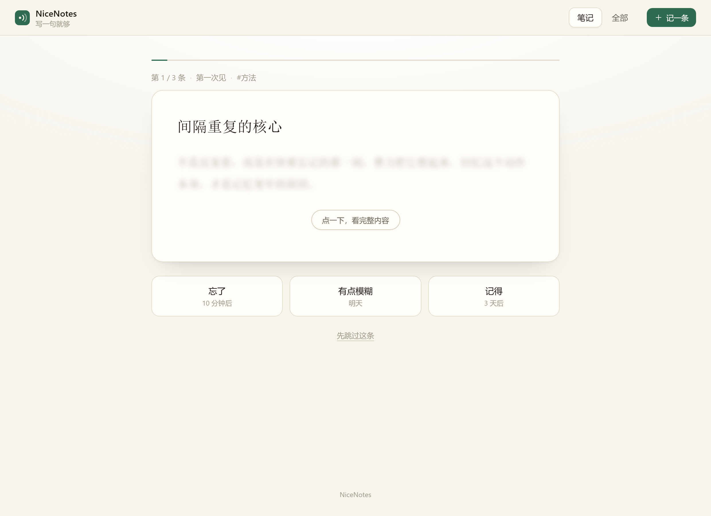
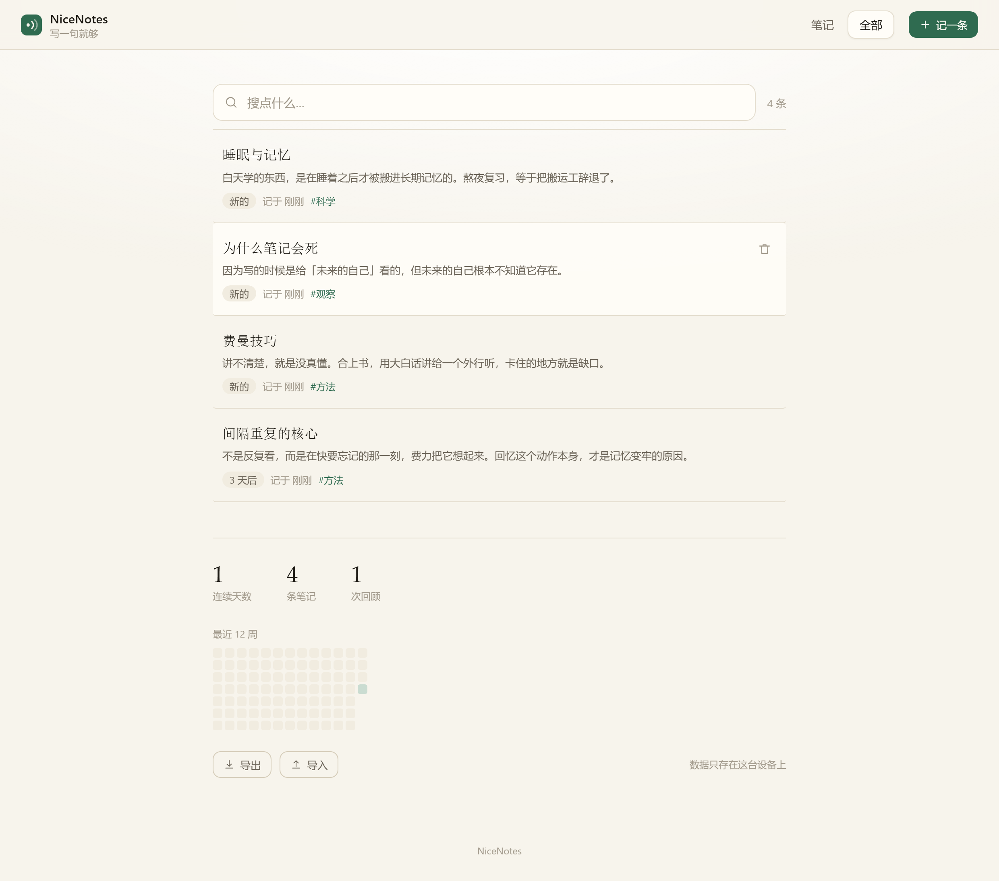

<div align="center">

# NiceNotes

**写一句就够，它会在你快忘记的时候回来找你一次。**

一个会自己复习的笔记工具。纯前端，零运行时依赖，所有数据只存在你自己的浏览器里。

[](https://www.typescriptlang.org/)
[](https://vitejs.dev/)
[](#license)

</div>



---

## 为什么又做了一个笔记工具

因为我发现，我打开过 MarkText、有道云笔记、备忘录，**但日常一个都不会点开**。

原因不是它们难用，是它们都只负责「记」，不负责「想起」。写的时候很有情绪，写完就进了坟场——那条笔记再也不会被任何人看到，包括未来的我自己。

所以 NiceNotes 只做一件事：

> 你随手写下一句话，在你快忘记的那一刻，它自己出现。

没有目录，没有分类，没有标签树。打开就是一个页面、一条笔记。看完按一个按钮，30 秒结束。

## 它是怎么工作的

整个产品是一个闭环，也是一套很朴素的记忆算法。

**1. 打开就是一条**

进来第一屏就是一条笔记，没有列表、没有侧边栏。想看全部的时候再切到「全部」，那里才有搜索。

**2. 第二行开始的内容会先藏起来**

```
间隔重复的核心          ← 标题，先给你看
[模糊] 不是反复看，而是…  ← 正文，糊掉，逼你先自己回想
```

有些笔记只有一句话，那就直接显示，没什么好藏的。

**3. 三个按钮决定它什么时候回来**

| 你的判断 | 下次 |
| --- | --- |
| 忘了 | 10 分钟后重来一次 |
| 有点模糊 | 1 天后，之后按 1.6 倍增长 |
| 记得 | 3 天 → 7 天 → 按难度系数拉开到几个月 |

算法脱胎于 SM-2，但改了三处：

- **「忘了」不打回零**。只把间隔清零、把难度系数调高，避免一条难记的笔记永远从头开始；
- **间隔增长由 ease 控制**，容易记的内容会迅速拉开到几个月后，不再骚扰你；
- **「有点模糊」的增长刻意比「记得」保守**，模糊就是模糊，不该假装记住了。

每个按钮下面直接写着下次时间，你不用猜系统怎么想。

**4. 该看什么，是加权随机挑的**

已到期的笔记按「逾期天数」加权抽取，逾期越久越容易被抽中。你感觉是随机撞见，其实是算法在挑。

每天最多补 3 条新笔记、最多 15 条到期回顾——刻意压得很低，让「打开就能用完」成为常态。一个永远做不完的待办清单，没人会打开第二次。

## 全部笔记



搜索、修改、删除都在这里。底部是连续天数、12 周回顾热力图，以及导出/导入 JSON。

**导出这个功能是必须的**：数据只存在你本机的 IndexedDB 里，没有任何服务器。好处是隐私和零成本，代价是换设备要自己搬——所以请偶尔点一下导出。

## 技术栈

| 方面 | 选择 | 为什么 |
| --- | --- | --- |
| 构建 | Vite 6 | 产物小，配置少 |
| 语言 | TypeScript | 数据模型值得被写清楚 |
| 界面 | 原生 DOM | 只有两个界面，框架的抽象收益小于它的体积 |
| 样式 | 原生 CSS | 视觉是整个项目的一部分，不想和工具类打架 |
| 存储 | IndexedDB | localStorage 有 5MB 上限且同步阻塞，笔记会越攒越多 |
| 依赖 | **0 个运行时依赖** | 别人可以把源码从头读到尾 |

构建产物：`~17KB` JS + `~11KB` CSS（gzip 后 7.5KB + 3.3KB）。

## 项目结构

```
src/
├── main.ts              入口
├── types.ts             数据模型
├── db.ts                IndexedDB 的一层薄封装
├── store.ts             状态与增删改查，加权抽取也在这
├── scheduler.ts         记忆排期算法（SM-2 改良）
├── styles/main.css      全部样式
├── ui/
│   ├── app.ts           外壳与路由
│   ├── note.ts          单条笔记界面
│   ├── library.ts       全部笔记 + 搜索 + 统计
│   ├── composer.ts      记录面板
│   └── icon.ts          内联图标
└── util/
    ├── date.ts          时间格式化
    └── dom.ts           建 DOM 的小帮手
```

## 本地运行

```bash
npm install
npm run dev      # http://localhost:5173
npm run build    # 类型检查 + 打包到 dist/
```

## 部署

仓库里带了 GitHub Actions（`.github/workflows/deploy.yml`），推到 `main` 后在仓库 Settings → Pages 里把 Source 选成 **GitHub Actions**，之后每次 push 都会自动发布。

因为是纯静态站点，丢到 Vercel、Netlify、Cloudflare Pages 也一样，不需要任何环境变量。

## 顺手把它变成新标签页

这是我最推荐的用法。一个需要你主动打开的网站，最后一定不会打开；而新标签页你每天要开几十次，躲都躲不掉。

`npm run build` 之后，在 `dist/` 里放一个 `manifest.json`：

```json
{
  "manifest_version": 3,
  "name": "NiceNotes",
  "version": "0.1.0",
  "chrome_url_overrides": { "newtab": "index.html" }
}
```

然后打开 `chrome://extensions` → 打开「开发者模式」→「加载已解压的扩展程序」→ 选 `dist/` 目录。

## 快捷键

| 键 | 作用 |
| --- | --- |
| `N` | 记一条 |
| `空格` | 展开被藏起来的正文 |
| `1` / `2` / `3` | 忘了 / 有点模糊 / 记得 |
| `Ctrl` / `⌘` + `Enter` | 在记录面板里保存 |

## 还没做的

- [ ] 真正的 PWA（离线可用 + 可安装）
- [ ] 笔记之间的双向链接
- [ ] 按标签筛选回顾范围
- [ ] 每日回顾提醒
- [ ] 导入 Markdown

## License

[MIT](LICENSE)
