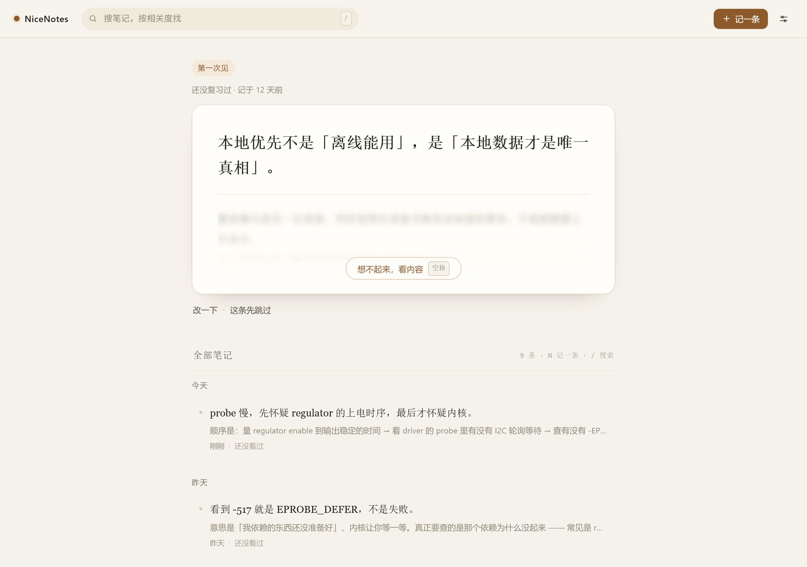
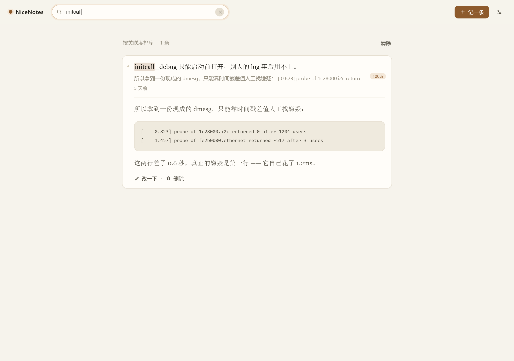
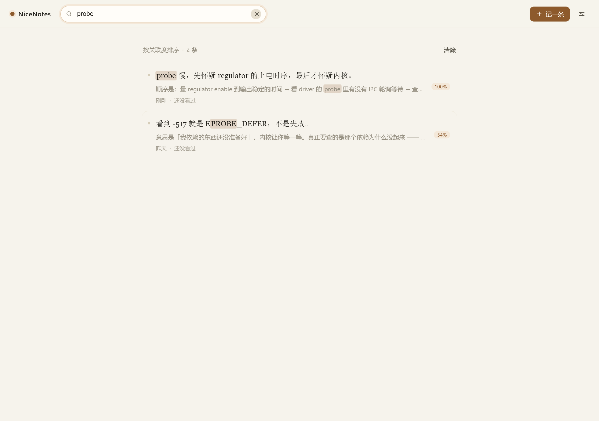
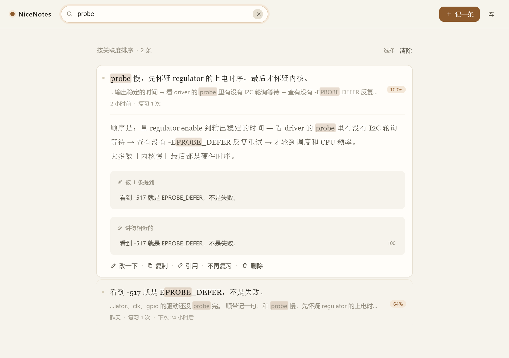
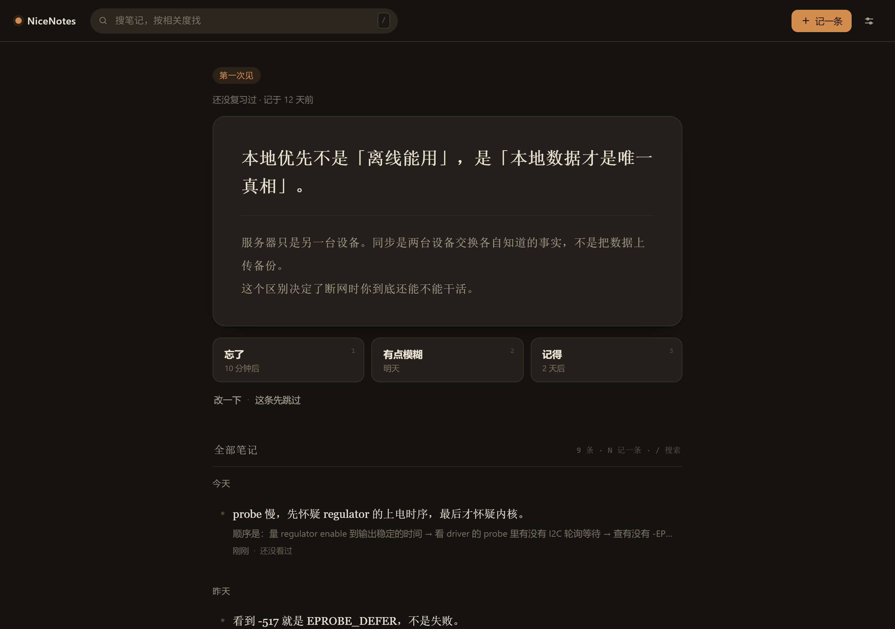

# NiceNotes

**Write one line. It comes back to find you just before you forget it.**

**English** · [简体中文](README.zh-CN.md)

[](../../actions)


[](https://hiwwhi.github.io/nicenotes/)



## This is not another note-taking app

Every note app you have installed works the same way: you write something in, and you never open it again. The problem is not the editor, and it is not whether it supports Markdown — **notes only go in and never come out.** Without an exit, a notebook becomes a graveyard.

So this project does exactly one thing: **it brings what you wrote back to you on a forgetting curve.**

## One stream, no folders

Open it and the first screen is always a single note, not a list:

- Something is due → that is the one on screen, and everything after the second line is blurred so you have to recall it yourself.
- Nothing is due → it **weighted-samples one note** from the whole library. The longer a note has gone untouched, the more likely it surfaces.

Scroll down and you get everything, grouped by day, one line per day. When you need to find something, search is always waiting at the top.

No directories, no tag trees, no "please create a notebook first." **You do not manage it. You just write.**


### Three buttons. Just three.

If you cannot recall it, expand it and answer one question: how much did you remember?

| Button | Meaning | Comes back |
|---|---|---|
| Forgot | Nothing came back | In 10 minutes |
| Fuzzy | Recalled it, but unsure | Tomorrow |
| Remembered | Crystal clear | In 2 days |

The interval stretches with every review, up to one year. The next review time is printed right under the buttons — that one line of small text is the most important feedback in the whole product. It is what makes you believe the system is really on top of this.

### Code and logs do not read as prose

Anything wrapped in backticks renders as a monospaced fragment, and three backticks fence off a whole block:

> 查有没有 `-EPROBE_DEFER` 反复重试

Return codes, register addresses and command names stand out from the sentence. A dmesg excerpt keeps its original indentation instead of melting into wrapped text.

Why not full Markdown: the `*` and `-` you type casually would turn into italics and lists, and the only thing in a note that genuinely needs layout is code.

Code blocks are syntax-coloured for `sh` / `bash`, `c` / `h` and `dts` / `dtsi`. No highlighter library — a full one is a few hundred KB, while code notes really only need comments, strings, numbers and keywords to be distinguishable. The whole thing adds 3KB.



## Search does not require the exact words

Search in most note apps is substring matching: mistype one character, or remember the meaning instead of the wording, and you get nothing.

Search here is **ranked by relevance, computed entirely on device** — no network, no model, no API key:

- Chinese has no spaces, so text is split into **bigrams** (`以太网` → `以太` / `太网`); English and digits are split on word boundaries
- Scoring is simplified TF-IDF: term frequency is log-damped, rarer terms carry more weight
- A hit in the first line gets an extra ×2.4 — the first line is the note's title, and that is what you are actually looking for
- Every result carries a percentage: how strongly it matches you

Typing `probe` finds both notes that mention it in the title and in the body, with the title matches ranked first. Typing `phy 复位` does not need to be exact — the split terms are matched and merged into one ranking.



### Expand a note and it brings up the ones about the same thing

You often write about one subject on several different days. Those notes usually share no vocabulary at all — "ETH down, suspect reset" and "confirmed: missing reset-gpio" have almost no characters in common. Keyword search will never connect them.

What this does is the half that can be done automatically: **expanding a note also hands you the few notes in your library that are genuinely about the same thing.**

The rule is "at least three meaningful terms must overlap." With only two, it is usually coincidence — words like "suspect" or "timing" that everybody uses. Better to surface nothing than to guess wildly.



No model involved. True semantic merging — connecting two notes that share no vocabulary but describe the same event — needs a model. That is the next step, and it stays an optional capability instead of binding the first release to an API key.

## The technically interesting parts

### 1. Local-first, not "works offline"

Every write goes to IndexedDB first, and local is always the source of truth. With no network it is the complete app, not a degraded one.

You can use it forever without an account, and not a single byte leaves the device. Signing in only adds one capability: getting your notes back on another device.

**It really does open with the network off.** A service worker keeps the page and its JS/CSS on disk: navigations go network-first and fall back to cache, hashed assets are cache-first, and `/api/` is never touched. So you get the newest version while online, and the last complete version while offline.

Relying on the browser's HTTP cache would not be enough — that expires. The way this is verified: clear the HTTP cache with `Network.clearBrowserCache`, go offline, reload. The page opens as usual, every note is there, and you can still write.

### 2. Sync is not a backup upload, it is two devices exchanging facts

This is where most of the work went. The usual way to "add sync" is to overwrite the whole library, and the moment two devices edit, you lose data. What is here instead is incremental sync with explicit conflicts:

```
client                          server
  │  POST /sync                  │
  │  since: 42                   │  → every note with seq > 42 (incremental pull)
  │  notes: [changed notes]      │  → compare updatedAt note by note
  │   each carries baseUpdatedAt │     both sides changed = real conflict
  │                              │     the loser is written to note_history
  │  ← { since, notes, conflicts }
```

The key is that every note carries an extra `baseUpdatedAt`: **the version the client saw at its last sync.** From that, the server can tell three cases apart:

| Server changed | Local changed | Result |
|---|---|---|
| No | No | Skip |
| Yes | No | Take the server version |
| No | Yes | Accept the local version |
| Yes | Yes | **Real conflict**: newest `updatedAt` wins, the loser goes to history |

The losing content is not destroyed. "Version history" in the UI shows every overwritten body, with one-click restore.

Last-write-wins only, no CRDT — CRDT would keep this project from ever shipping.

### 3. "Random" is weighted, not uniform

With uniform randomness, a note you memorized long ago and one you are about to forget are equally likely to appear. Two weeks in, it keeps showing you things you already know.

The actual weight is `1 + days since you last touched it`, capped at 30. The cap is deliberate: without it, a note left alone for six months would dominate your screen for three days straight, and then you would uninstall.

### 4. Zero native dependencies on the backend

The database is Node 22's built-in `node:sqlite` — no compiling `better-sqlite3`, no Python toolchain, `npm ci` and it runs. The entire backend has two dependencies: `hono` and `@hono/node-server`.

Passwords use `scrypt` with a random salt, sessions are random 32-byte tokens, and the login endpoint has naive rate limiting. All of it from the standard library.

### 5. No frontend runtime dependencies besides React

No UI kit, no state management library, no icon set, no CSS framework. One `styles.css`, colors as CSS variables, light and dark. Icons are hand-written SVG.

State lives in a single `store.ts` read through `useSyncExternalStore` — no Redux, no nested Context.



## Quick start

### Docker (recommended, one command)

```bash
git clone https://github.com/HiwwHi/nicenotes.git
cd nicenotes
docker compose up -d
```

Open <http://127.0.0.1:8787>. The database lives in the `nicenotes-data` volume, so removing the container does not lose it.

### Local development

Requires Node.js 22.5 or newer (`node:sqlite` is available from that version).

```bash
npm install
npm run dev
```

- Frontend <http://127.0.0.1:5183> (Vite, `/api` proxied to the backend)
- Backend <http://127.0.0.1:8787>

Production mode:

```bash
npm run build
npm start          # the backend also serves the built frontend, single port
```

### Live demo

**<https://hiwwhi.github.io/nicenotes/>**

A purely static build, published by `pages.yml` on every push to `main`. It **has no backend** — the sync UI hides itself and everything else works, which is enough to show the interface and interactions are real. For sync, run `docker compose up` yourself.

## Keyboard shortcuts

| Key | Action |
|---|---|
| <kbd>Space</kbd> | Expand the note |
| <kbd>1</kbd> <kbd>2</kbd> <kbd>3</kbd> | Forgot / Fuzzy / Remembered |
| <kbd>N</kbd> | New note |
| <kbd>/</kbd> | Jump to search |
| <kbd>Esc</kbd> | Clear search / leave settings |
| <kbd>Ctrl</kbd>+<kbd>Enter</kbd> | Save |

## Project layout

```
nicenotes/
├─ web/                       frontend: React 19 + TypeScript + Vite
│  ├─ src/
│  │  ├─ store.ts             state + note selection + sync orchestration (single source of truth)
│  │  ├─ lib/
│  │  │  ├─ scheduler.ts      a variant of SM-2 scheduling
│  │  │  ├─ search.ts         bigram tokenizing + TF-IDF relevance ranking
│  │  │  ├─ db.ts             hand-written IndexedDB wrapper, no library
│  │  │  ├─ api.ts            backend client
│  │  │  └─ stats.ts          streaks, 12-week heatmap
│  │  ├─ components/
│  │  │  ├─ Stream.tsx        one stream: hero card + all notes grouped by day
│  │  │  ├─ ReviewCard.tsx    hides the second half, three rating buttons
│  │  │  ├─ PeekCard.tsx      when nothing is due, one note it surfaced
│  │  │  ├─ NoteItem.tsx      one note in the stream, expands to full text + related notes
│  │  │  ├─ Composer.tsx      new note / edit / version history
│  │  │  └─ Settings.tsx      account, records, appearance, data
│  │  └─ styles.css           all styling, colors as CSS variables
│  └─ public/                 icons, manifest, service worker (offline cache)
├─ server/                    backend: Hono + node:sqlite
│  └─ src/
│     ├─ index.ts             routes, auth middleware, static hosting
│     ├─ auth.ts              scrypt passwords, session tokens, rate limiting
│     ├─ sync.ts              incremental sync and conflict merging
│     └─ db.ts                schema and queries
├─ Dockerfile                 two-stage build, runtime-only final image
└─ docker-compose.yml         service + data volume
```

## Data and privacy

- Not signed in: everything stays in the browser's IndexedDB, and "Export JSON" takes it with you.
- Signed in: notes sync to your own server. No third party in the path.
- Existing `.md` files can be imported as-is: a file with `## ` sections is split per section, otherwise the whole file becomes one note. Identical content is skipped, so importing twice does not duplicate anything.
- Search, related-note suggestions and scheduling all run in the browser. They make no requests.
- No analytics, no tracking, no third-party fonts or CDNs.
- Nine sample notes are seeded on first open. They are never synced; once an account you sign into already has content, they are removed.

## Known limitations

- **No rich text and no images.** The product assumes "one line plus a paragraph." Adding an editor would destroy that assumption.
- **Related notes match words, not meaning.** Two notes that describe the same thing in completely different words will not be connected — that needs a model, and it is next.
- **Sync is last-write-wins.** Edit the same passage on two devices and the later one wins while the earlier one goes to history. Sentences are not merged automatically.
- **No password recovery.** Email only identifies an account, nothing is sent. Forget the password and you start a new account — the price of not wiring up an email service.
- **On iPhone, PWA storage gets evicted by the system** if you do not open it for a long time. So for long-term phone use, a server and an account are required, not optional.

## License

[MIT](LICENSE) · use it, change it, ship it commercially.

---

If it reminded you of something you would otherwise have forgotten, a **Star** is the best way to say thanks.
