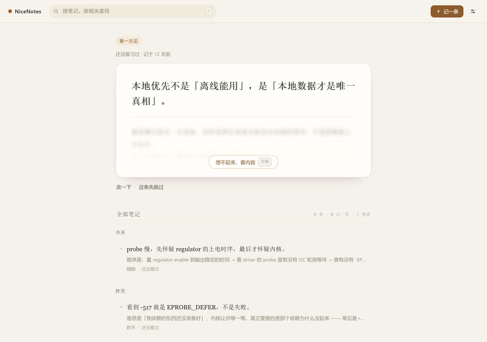
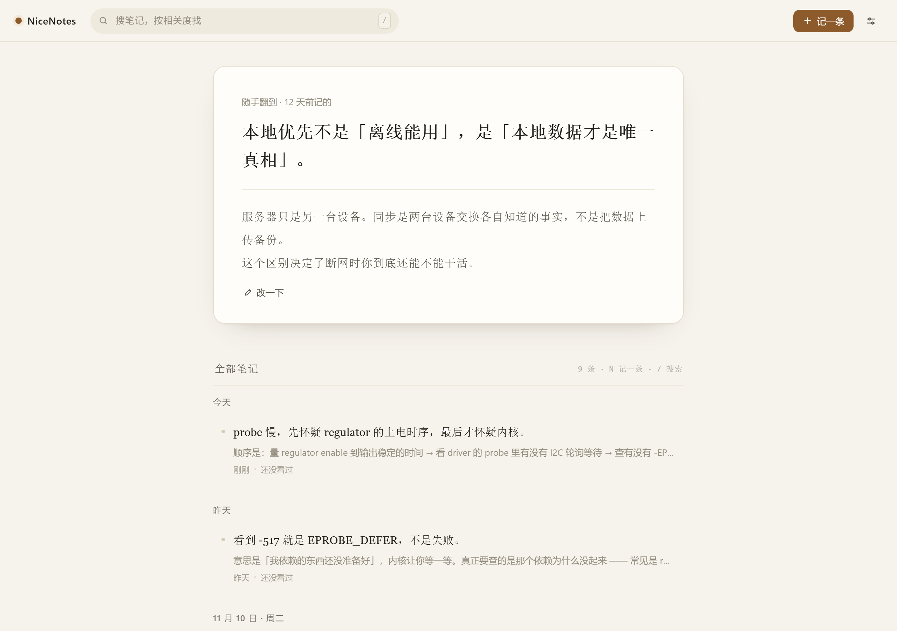
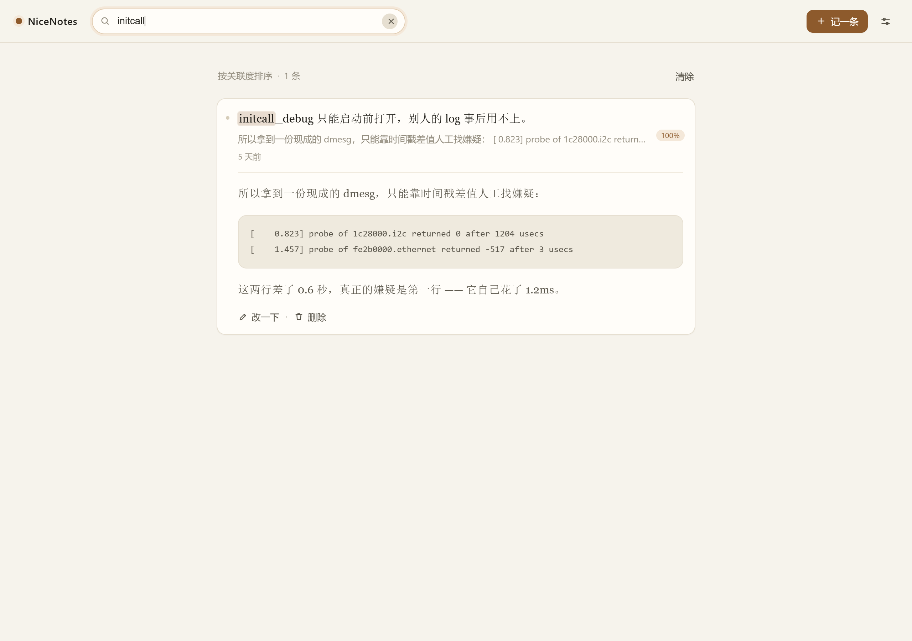
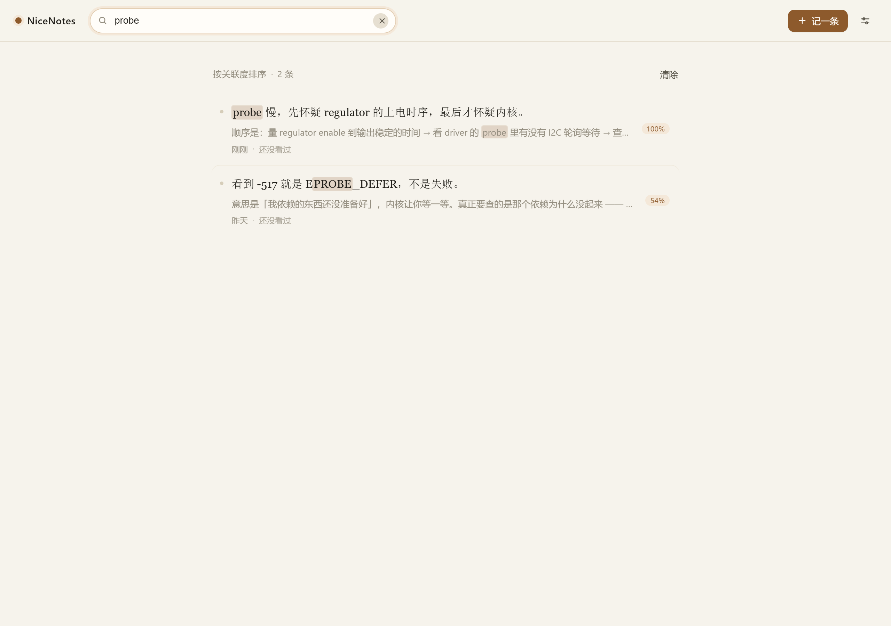
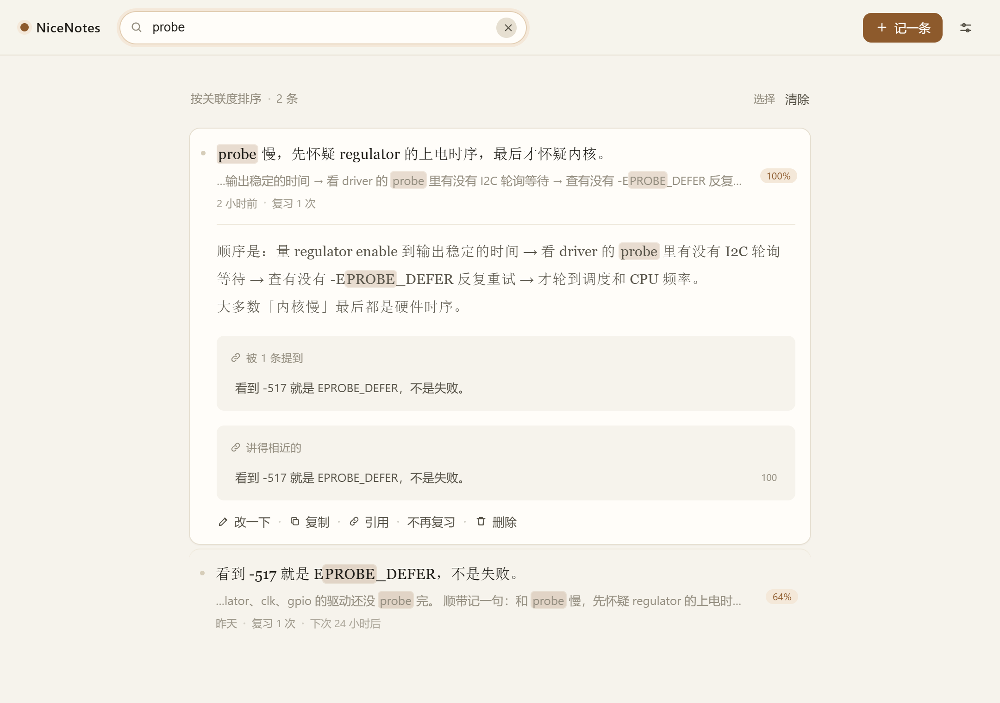
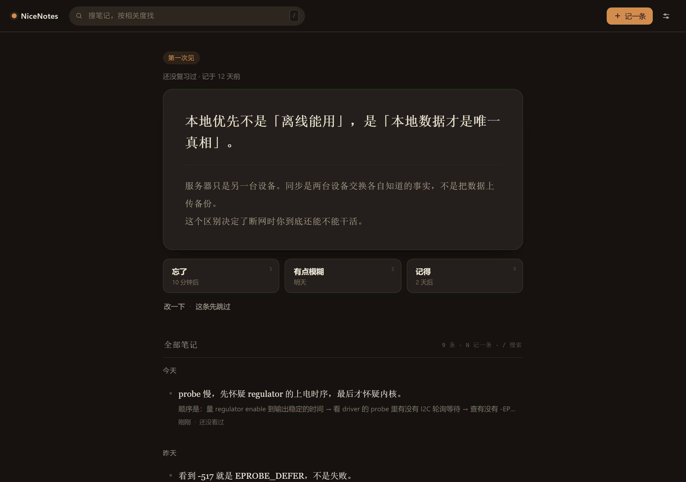

# NiceNotes

**写一句就够。它会在你快忘记的时候，自己回来找你一次。**

[English](README.md) · **简体中文**

[](../../actions)


[](https://hiwwhi.github.io/nicenotes/)



## 这不是又一个笔记工具

你装过的笔记软件大概都是这样：写进去，然后再也不打开。问题不在编辑器，也不在 Markdown 支持好不好——**笔记只进不出**，没有出口，就变成坟墓。

所以这个项目只做一件事：**让你写下的东西按遗忘曲线回来找你。**

## 一个流，不分文件夹

打开它，第一屏永远是一条笔记，不是一个列表：

- 有该复习的 → 就是那一条，第二行之后先糊住，逼你自己回想
- 没有该复习的 → 从全部笔记里**加权抽一条**，越久没碰过的越容易被翻到

往下滚就是全部笔记。顺序可以切：

- **按时间**——按天分组，一天一段，像一份不断往下追加的 Markdown 文件，从最新的往回翻
- **随机**——打散了看，再点一下换一批，翻到哪条算哪条

想找什么，顶部的搜索一直等在那里。

没有目录、没有标签树、没有「请先创建笔记本」。**你不需要管理它，你只需要写。**



### 三个按钮，就三个

想不起来就展开看，然后回答一个问题：你记得多少？

| 按钮 | 含义 | 下次出现 |
|---|---|---|
| 忘了 | 完全没想起来 | 10 分钟后 |
| 有点模糊 | 想起来了，但不确定 | 明天 |
| 记得 | 清楚记得 | 2 天后 |

间隔会随复习次数拉长，最长一年。按钮下面直接写着下次时间——这行小字是整个产品最重要的反馈，它让你相信系统真的在管这件事。

点错了也不用慌：评完会出一条带「撤销」的提示，把间隔、复习次数、今天的计数一起退回去。

每天只安排 3 条新的，剩下的到日子才回来。今天看完了也不妨碍多过一遍——卡片底部有「提前复习一条」，会挑最早到期的那条。

### 一页装不下的时候

列表里点「选择」进多选，勾几条一起归档或删除；勾错了按 Esc 退出。批量操作同样带撤销。

整条笔记可以一键复制（保留围栏和 `[[ ]]` 原样），发给同事或者粘进别的工具都还是可读的格式。

Ctrl+P 打印时顶栏、按钮、模糊遮罩都会去掉：**展开了某一条就只打这一条**，什么都没展开则打全部。宽表格和长代码行会折行，不会被切成半截。

### 代码和 log 不会被当成普通文字

用反引号包住的部分显示成等宽片段，三个反引号围起来的是一整块代码：

> 查有没有 `-EPROBE_DEFER` 反复重试

返回码、寄存器地址、命令名会从正文里跳出来；dmesg 片段会保留原来的缩进和对齐，不会因为自动换行糊成一片。

**支持的是结构，不是强调。** 代码块、行内代码、表格、列表、`[[内链]]`、正文里的网址都认；斜体、粗体、标题不做——你随手写的 `*` 和 `_` 会被它们变成样式，而笔记里真正需要的其实是结构。

行首写 `- ` 或 `1. ` 就是列表，`| 表头 |` 加一行 `|---|---|` 就是表格。围栏里的内容一律不解析，`dmesg -w` 里的横线不会把命令变成列表。

代码块会按语言着色，认得 `sh` / `bash`、`c` / `h`、`dts` / `dtsi`、`make` / `Makefile`、`py` / `python`、`json`。没引高亮库——完整的 highlight.js 要几百 KB，而代码笔记真正要区分的只有注释、字符串、数字、关键字这几类。整件事只让产物涨了几 KB。

每块右上角有「复制」，看 dmesg 时不用再手动框选。



### 写的时候

- 写到一半被打断（手机来电、误关标签页），内容不会丢：停手半秒就存草稿，下次打开「记一条」自动接上
- 右上角能切「写 / 预览」，代码块围栏漏了闭合、语言标记写错，存之前就看得见
- 没闭合的围栏按代码块渲染到文末，和大多数编辑器一致

## 搜索不要求你记得原话

大多数笔记软件的搜索是「子串匹配」：你打错一个字，或者只记得意思不记得用词，就什么都找不到。

这里的搜索是**按相关度排序**的，而且完全在本地算，不联网、不调模型、不需要 API key：

- 中文没有空格，按**二元组**切分（`以太网` → `以太` / `太网`），英文和数字按词切
- 打分是简化的 TF-IDF：词频取 log 压一下，越少见的词权重越高
- 首行命中额外 ×2.4 —— 笔记的第一行就是它的标题，那才是你真正想找的东西
- 结果带一个百分比，是你和这条笔记的相关度

打 `probe` 会同时找到标题里有它和正文里有它的笔记，前者排在前面。打 `phy 复位` 不用打全，拆开的词各自命中也会合并排序。

**也能打拼音**：脑子里先出现的是读音，手上打出来就是 `ytw`。搜索框里输纯字母时会再按一次拼音首字母匹配，覆盖 GB2312 一级汉字 3755 个——表是离线生成的，运行时不带拼音库，gzip 后 8.6KB。

搜到的词藏在正文深处时，列表里的预览会从命中处截取，展开后也会自动滚到那一行，不用自己往下翻。搜完按 <kbd>Enter</kbd> 直接展开第一条，手不用离开键盘。



### 展开一条，它会把讲得相近的带出来

同一件事，你可能会在不同日子各记一点。这些点之间通常没有相同的词——「ETH 不通，怀疑复位」和「确认了，是 reset-gpio 漏配」几乎没有一个字重合，靠关键词永远连不起来。

这里做的是能自动做到的那一半：**展开一条笔记时，把它和全库里真正讲得相近的几条一起给你**。

判定标准是「至少撞上三个有分量的词」——只撞两个的时候，多半是「怀疑」「时序」这类各说各话的巧合，推出来只会让人觉得在乱猜。宁可少推，不可乱推。



这一步不需要模型。真正的语义归并（把两条用词完全不同、讲的是同一件事的笔记连起来）需要模型，那是下一步的事，我把它留成一个可选能力，而不是第一版就绑死一个 API key。

**自动连不上的，可以手动连。** 在正文里写 `[[另一条的标题]]`，渲染成一条虚线链接，点了直接跳过去；跳走之后目标顶部会有「← 回到「刚才那条」」，顺着内链读几层也能一层层退回来。标题记不全没关系，先精确匹配，匹配不上再退一步做包含匹配。

## 技术上有意思的地方

### 1. 本地优先，不是「离线可用」

所有数据先写 IndexedDB，永远以本地为准。没有网络的时候它就是完整的应用，不是降级版。

不登录也能一直用，一个字节都不会离开这台设备。登录只是多一个能力：换设备时把笔记接回来。

**断网真的能打开。** 一个 service worker 把页面和 JS/CSS 都留在本地：页面请求走「先用网络、失败读缓存」，带 hash 的静态资源走「缓存优先」，`/api/` 一律不碰。这样在线时永远是最新版，断网时退回上一份完整的界面。

光靠浏览器 HTTP 缓存不算数——那个会过期。验证方式是先 `Network.clearBrowserCache` 清掉 HTTP 缓存，再断网刷新：页面照常打开，笔记都在，还能继续写。

### 2. 同步不是上传备份，是两台设备交换事实

这是这个项目真正花时间的部分。绝大多数「加个同步」的做法是「整库覆盖」，两台设备同时改就丢数据。这里做的是增量 + 冲突显式化：

```
客户端                          服务端
  │  POST /sync                  │
  │  since: 42                   │  → 取 seq > 42 的所有笔记（增量拉取）
  │  notes: [改过的笔记]           │  → 逐条比较 updatedAt
  │   每条带 baseUpdatedAt        │     双方都改过 = 真冲突
  │                              │     落败的一方写进 note_history
  │  ← { since, notes, conflicts }
```

关键在于每条笔记多带一个 `baseUpdatedAt`：**客户端上次同步时看到的版本**。服务端据此能分清三种情况：

| 服务端变了 | 本地变了 | 处理 |
|---|---|---|
| 否 | 否 | 跳过 |
| 是 | 否 | 直接用服务端版本 |
| 否 | 是 | 接受本地版本 |
| 是 | 是 | **真冲突**：`updatedAt` 新的赢，输的那份进历史 |

输掉的内容不会消失。界面上「历史版本」能看到每一次被覆盖的正文，一键恢复。

只做最后写入胜，不做 CRDT —— CRDT 能让这个项目永远发不出去。

### 3. 「随机」是加权的，不是真随机

如果纯随机，一条你早就记牢的和一条明天就要忘的，被抽中的概率一样。用两周你会发现它老给你看已经会的东西。

实际权重是 `1 + 距上次碰它的天数`，上限 30 天。上限定在这里是有原因的：不设上限，一条放了半年的笔记会连续三天霸占你的屏幕，然后你就卸载了。

### 4. 后端零原生依赖

数据库用 Node 22 内置的 `node:sqlite`，不用编译 `better-sqlite3`，不用 Python 工具链，`npm ci` 装完就能跑。整个后端只有两个依赖：`hono` 和 `@hono/node-server`。

密码用 `scrypt` + 随机盐，会话是随机 32 字节令牌，登录接口有朴素限流。这些都在标准库里。

### 5. 除了 React，前端没有别的运行时依赖

没有 UI 库、没有状态管理库、没有图标库、没有 CSS 框架。`styles.css` 一个文件，配色全走 CSS 变量，深浅两套。图标是手写的 SVG。

状态只有一个 `store.ts`，用 `useSyncExternalStore` 订阅——不需要 Redux 也不需要 Context 嵌套。



## 快速开始

### Docker（推荐，一条命令）

```bash
git clone https://github.com/HiwwHi/nicenotes.git
cd nicenotes
docker compose up -d
```

打开 <http://127.0.0.1:8787>。数据库落在 `nicenotes-data` 卷里，删容器不丢数据。

要放到公网、配 HTTPS、做备份，看 **[docs/DEPLOY.md](docs/DEPLOY.md)**——从一台空机器到手机上能用，大约十分钟。

### 本地开发

需要 Node.js 22.5 以上（`node:sqlite` 从这版开始可用）。

```bash
npm install
npm run dev
```

- 前端 <http://127.0.0.1:5183>（Vite，`/api` 已代理到后端）
- 后端 <http://127.0.0.1:8787>

生产模式：

```bash
npm run build
npm start          # 后端同时托管前端静态文件，只有一个端口
```

### 演示站

**<https://hiwwhi.github.io/nicenotes/>**

`pages.yml` 在每次推送到 `main` 时自动发布纯静态版本。
那个版本**没有后端**，同步功能会自动隐藏，其余功能完整——它能证明界面和交互是真的，同步得自己 `docker compose up` 才有。

### 装到手机上

它不是原生 App，是一个 PWA。区别在于：一套代码电脑手机都能跑，不用上架审核，改了立刻生效。

- **iPhone**：Safari 打开后可以「分享 → 添加到主屏幕」，也可以直接装根目录下的 `nicenotes.mobileconfig` 描述文件，装完主屏直接出现一个全屏图标。（没签名，安装时 iOS 会提示「未验证」，点继续即可。）
- **Android**：Chrome 会主动提示「添加到主屏幕」，或者从菜单里手动加。
- **电脑**：Chrome / Edge 地址栏右边有个安装图标，点一下就是独立窗口，有自己的图标，没有地址栏。

装完之后断网也能打开——页面和 JS/CSS 都在本地缓存里。

## 快捷键

| 键 | 作用 |
|---|---|
| <kbd>空格</kbd> | 展开内容 |
| <kbd>1</kbd> <kbd>2</kbd> <kbd>3</kbd> | 忘了 / 有点模糊 / 记得 |
| <kbd>N</kbd> | 记一条 |
| <kbd>/</kbd> | 跳到搜索框 |
| <kbd>Enter</kbd> | 搜索结果里直接看第一条 |
| <kbd>Esc</kbd> | 清空搜索 / 退出设置 |
| <kbd>Ctrl</kbd>+<kbd>Enter</kbd> | 保存 |
| <kbd>Ctrl</kbd>+<kbd>P</kbd> | 打印（展开着就只打那一条） |

## 目录结构

```
nicenotes/
├─ web/                       前端：React 19 + TypeScript + Vite
│  ├─ src/
│  │  ├─ store.ts             状态 + 选题 + 同步编排（唯一的状态来源）
│  │  ├─ lib/
│  │  │  ├─ scheduler.ts      SM-2 改良版排期
│  │  │  ├─ search.ts         二元组切分 + TF-IDF 相关度检索
│  │  │  ├─ pinyin.ts         汉字转拼音首字母（表是离线生成的）
│  │  │  ├─ rich.ts           正文解析：围栏、行内码、表格、列表、内链
│  │  │  ├─ syntax.ts         代码着色，六类 token
│  │  │  ├─ db.ts             IndexedDB 手写封装，不引库
│  │  │  ├─ api.ts            后端客户端
│  │  │  ├─ markdown-import.ts 导入 .md 时按 `## ` 拆条
│  │  │  ├─ date.ts           日期分组的文案
│  │  │  ├─ stats.ts          连续天数、12 周热力图
│  │  │  ├─ history.ts        最近搜过的词
│  │  │  ├─ shuffle.ts        带种子的洗牌（顺序稳定）
│  │  │  ├─ theme.ts          浅色 / 深色 / 跟随系统
│  │  │  └─ clipboard.ts      写剪贴板（带 execCommand 兜底）
│  │  ├─ components/
│  │  │  ├─ Stream.tsx        一个流：主角卡 + 按天分组的全部笔记
│  │  │  ├─ ReviewCard.tsx    遮住后半、三个评分按钮
│  │  │  ├─ PeekCard.tsx      没有复习任务时，随手翻到的一条
│  │  │  ├─ NoteItem.tsx      流里的一条，点开看全文和相近的笔记
│  │  │  ├─ Rich.tsx          正文渲染 + 代码块复制
│  │  │  ├─ Composer.tsx      记一条 / 编辑 / 预览 / 历史版本
│  │  │  └─ Settings.tsx      账号、记录、外观、数据
│  │  └─ styles.css           全部样式，配色走 CSS 变量
│  └─ public/                 图标、manifest、iOS 描述文件、service worker
├─ server/                    后端：Hono + node:sqlite
│  └─ src/
│     ├─ index.ts             路由、鉴权中间件、静态托管
│     ├─ auth.ts              scrypt 密码、会话令牌、限流
│     ├─ sync.ts              增量同步与冲突合并
│     └─ db.ts                表结构与查询
├─ scripts/check-server.mjs   后端自检：起临时进程跑 22 项接口检查
├─ docs/DEPLOY.md             从空机器到手机上能用的部署步骤
├─ Dockerfile                 两阶段构建，产物镜像只带运行时
└─ docker-compose.yml         起服务 + 数据卷
```

## 数据与隐私

- 不登录：所有数据只在浏览器的 IndexedDB 里，`导出 JSON` 随时带走。
- 登录：笔记同步到你自己的服务端，不经过任何第三方。
- 三种导出：`JSON` 给自己备份、`Markdown` 给别的工具读、`HTML` 给不装应用的人看（双击就能打开，样式内联、不含脚本）。
- 已有的 `.md` 笔记可以直接导入：文件里有 `## ` 分节会按节拆成多条，没有就整个文件当一条；内容一样的自动跳过，重复导入不会翻倍。
- 搜索、相近推荐、排期，全部在浏览器里算，不发任何请求。
- 没有统计脚本、没有埋点、没有第三方字体和 CDN。
- 第一次打开会塞 9 条示例笔记。它们不会被同步；一旦登录的账号里已经有内容，示例会被清掉。
- 设置 → 数据 → **清空这台设备的笔记**，连点两次执行。登录状态下清空只是把本地清掉、随后从服务器重新拉一遍，云端不受影响。
- 本地笔记是跟着「这台设备」走的，不是跟着账号。同一台机器换账号登录时，会提示上一个账号还留了多少条，以免两个人共用一台电脑时串数据。

## 已知限制

- **不做富文本和图片**。这个产品的假设是「一句话 + 一段解释」，加编辑器会毁掉这个假设。
- **相近推荐只看词，不看意思**。用词完全不同的两条笔记它连不起来——那需要模型，是下一步。
- **同步是最后写入胜**。同一段文字在两台设备上同时修改，晚的那份赢，早的那份进历史。不会自动合并句子。
- **没有找回密码**。邮箱只用于区分账号，不发信。忘了密码等于换账号——这也是不接邮件服务换来的简单。
- **iPhone 上的 PWA 存储会被系统清理**（长期不打开时）。所以手机端真要长期用，服务器和账号是必需的，不是可选项。

## 许可

[MIT](LICENSE) · 随便用、随便改、商用也可以。

---

如果它让你想起了某条本来会忘掉的东西，点个 **Star** 就是最好的支持。
